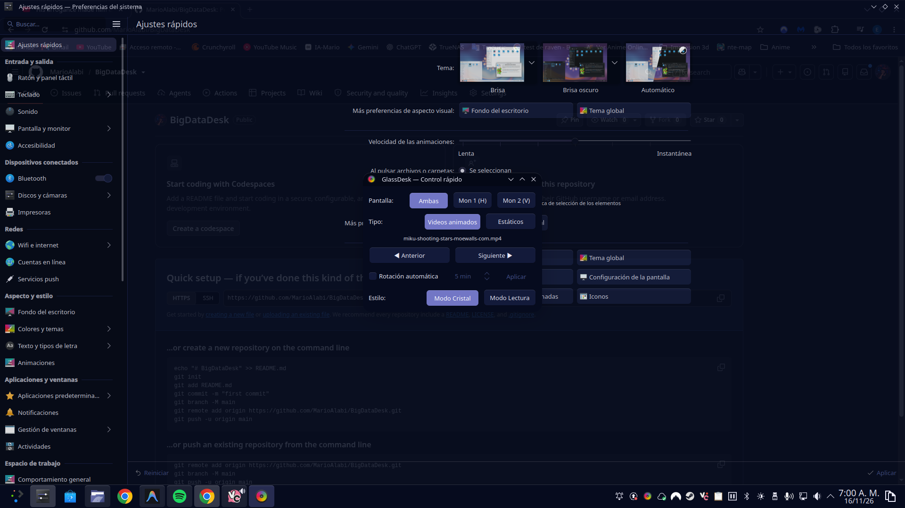
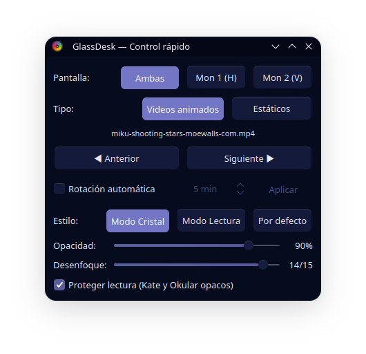

# BigDataDesk

Configuración personal para **KDE Plasma 6 (Wayland)** con estética *frosted-glass*, transparencia selectiva, esquemas de color unificados y un controlador ligero en la bandeja del sistema (`glassdesk-tray` + `glassdesk-popup`) para alternar fondos animados/estáticos, rotación automática y modo cristal/lectura.

> [!NOTE]
> **Sin mantenimiento activo:** Este repositorio se comparte tal cual está para uso personal y de conocidos. No habrá soporte ni actualizaciones garantizadas — si te sirve y quieres adaptarlo o mantenerlo, siéntete libre de hacer un **fork**.

## Capturas

### Escritorio y transparencia selectiva


### Control rápido flotante (`glassdesk-popup`)


---

## Qué incluye y cómo funciona

* **Estética cristal + desenfoque real:** Configura **Darkly** + **Better Blur DX** (`BlurStrength=14`, `CornerRadius=8`, `ForceContrastParams=true`) para dar efecto vidrio esmerilado incluso en terminales GTK4 como **Ptyxis** y apps nativas de KDE, con barras deslizantes en tiempo real para ajustar **Opacidad (`40%–100%`)** y **Desenfoque (`1–15`)**, botón **Por defecto** y opción **Proteger lectura (`Kate` y `Okular` opacos)** para evitar cansancio visual al apilar texto sin oscurecer otros monitores.
* **Transparencia selectiva (`kwinrulesrc`):** Aplica opacidad (`90%` activa / `84%` inactiva) **solo** a apps nativas de KDE (`Dolphin`, `Preferencias del sistema`, `Konsole`, `Kate`, `Ark`, `KCalc`, `Okular`, `Spectacle`). Navegadores, reproductores y YouTube permanecen al `100%` opacos.
* **9 temas + acentos sincronizados:** `Tokyo Night`, `Ethereal`, `Kanagawa`, `Nord`, `Catppuccin`, `Matte Black`, `Jade Horse`, `Everforest` y `Gruvbox`, sincronizados con **KDE Plasma**, **Ptyxis** y **Konsole**.
* **Soporte multimonitor inteligente:** Detecta dinámicamente cuántas pantallas activas tienes (si solo hay 1, oculta el selector de monitores) y detecta orientación **horizontal vs vertical** (usando `Vertical/` si hay contenido, o aplicando ajuste con relleno desenfocado si no).
* **Controlador ligero:**
  * `glassdesk`: CLI en Python (`0 MB` en reposo).
  * `glassdesk-tray`: daemon nativo en Rust (`ksni`, ~`4–5 MB` RAM) con bloqueo de instancia única.
  * `glassdesk-popup`: ventana flotante en PySide6 que no se cierra al hacer clic para ir probando fondos cómodamente.
* **Rotación independiente:** Activa o desactiva la rotación automática y sus minutos por separado para **Videos animados** y **Estáticos**.
* **Parche para video en segundo plano:** Ajusta `TasksModel.qml` de *Smart Video Wallpaper Reborn* para que el video siga reproduciéndose detrás de ventanas transparentes maximizadas (`Ptyxis`, `Dolphin`, `Konsole`, etc.), pausándose únicamente ante apps opacas o pantalla completa.

---

## Instalación

> Compatible con **Fedora KDE** (`dnf`) y **Arch / CachyOS KDE** (`pacman` + `paru`/`yay`). En otras distros con KDE Plasma 6 funciona instalando manualmente los requisitos listados abajo y ejecutando `./install.sh --skip-deps`.

```bash
git clone https://github.com/MarioAlabi/BigDataDesk.git
cd BigDataDesk
./install.sh
```

### Dónde colocar tus fondos (no incluidos en el repo)
Por tamaño y derechos de autor, el repositorio **no incluye** los videos ni imágenes originales. Coloca tus propios archivos en:

* **Videos animados (`.mp4`, `.webm`, `.mkv`):**
  * Horizontal: `~/Vídeos/Fondos/` *(o `~/Videos/Fondos/` si tu sistema está en inglés)*
  * Vertical *(opcional)*: `.../Fondos/Vertical/`
* **Imágenes estáticas (`.webp`, `.png`, `.jpg`, `.jpeg`):**
  * Horizontal: `~/.local/share/wallpapers/Fondos/`
  * Vertical *(opcional)*: `~/.local/share/wallpapers/Fondos/Vertical/`

---

## Cómo actualizar (sin duplicar instalaciones)

El script `install.sh` es **idempotente**: detecta instalaciones previas, detiene limpiamente la instancia activa de `glassdesk-tray`, sobreescribe los mismos binarios y perfiles en su sitio, actualiza la regla `glassdesk-kde-apps` en `kwinrulesrc` sin duplicarla y **conserva** tu estado actual (`state.json`) y tus carpetas de fondos.

```bash
cd BigDataDesk
./install.sh --update
```

Si solo cambiaron scripts/perfiles y no quieres volver a pasar por `dnf`/`pacman`:

```bash
cd BigDataDesk && git pull --ff-only && ./install.sh --skip-deps
```

---

## Desinstalación

Para eliminar binarios, autostart, esquemas y regla de ventana de KWin (sin borrar tus fondos y restaurando el respaldo inicial si existe):

```bash
cd BigDataDesk
./uninstall.sh
```

---

## Dependencias y créditos de terceros

Durante `./install.sh`, los siguientes proyectos se instalan o descargan directamente desde sus fuentes oficiales bajo sus respectivas licencias:

* [Darkly](https://github.com/Bali10050/Darkly) (`GPLv2`) — Estilo Qt y decoración de ventanas.
* [kwin-effects-better-blur-dx](https://github.com/xarblu/kwin-effects-better-blur-dx) (`GPLv3`) — Efecto blur mejorado para KWin Wayland.
* [Smart Video Wallpaper Reborn](https://github.com/luisbocanegra/plasma-smart-video-wallpaper-reborn) (`GPLv2+`) — Plugin de fondos de video para Plasma 6.
* [Sweet-folders](https://github.com/EliverLara/Sweet-folders) (`GPLv3`) — Variantes de carpetas `Sweet-Red` y `Sweet-Red-Filled`.
* [Neonyt-Dark-Icons](https://www.pling.com/p/1463720/) (`GPLv3`) — Paquete de iconos base.
